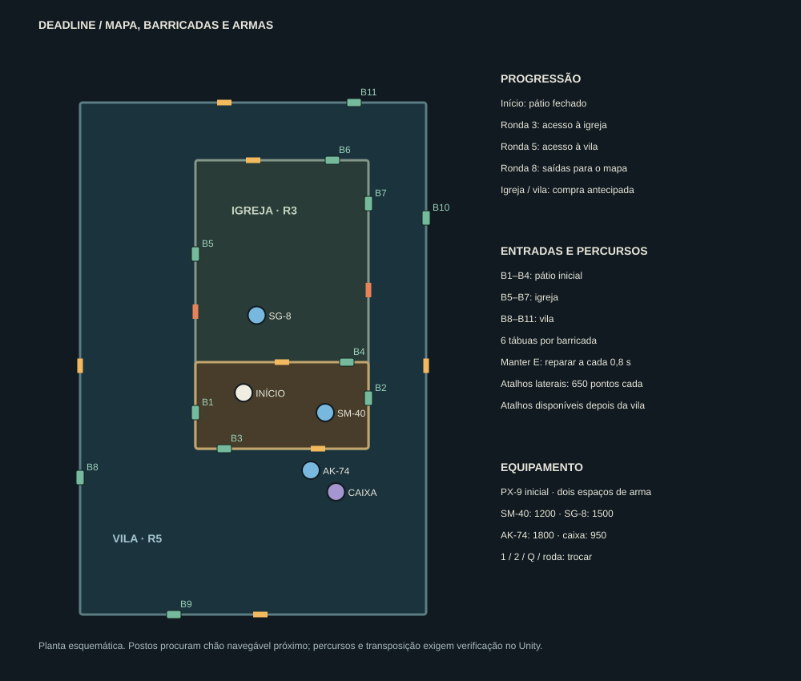

# Mapa, barricadas e armas

O jogador passa a começar com uma pistola e a preparar dois espaços de equipamento. As áreas ganham
entradas destrutíveis, compras específicas e dois atalhos que permitem variar os percursos de fuga.
Os portões principais e a abertura automática nas rondas 3, 5 e 8 mantêm-se.

A planta representa a disposição dos sistemas no mapa existente; não é uma captura do Unity nem prova de navegação.
As posições dos postos são projetadas sobre o NavMesh, podendo deslocar-se para um ponto acessível próximo.

## Percursos e entradas

- **Pátio inicial:** quatro janelas, reabastecimento e compra da SM-40. A pistola dá tempo para juntar pontos antes de escolher equipamento ou abertura antecipada.
- **Igreja:** três novas entradas e compra da SG-8. O acesso principal fica junto ao arco original.
- **Vila:** quatro novas entradas, AK-74, caixa misteriosa e o posto de energia/vantagens.
- **Atalhos oeste/este:** duas saídas laterais da igreja, 650 pontos cada, disponíveis depois da vila. Abrem colisão e carving juntos e ficam guardadas.
- **Orientação:** placas com setores e destinos. Não foram acrescentadas luzes espalhadas pelo cenário.

As janelas têm peitoril sólido, pilares, lintel, seis tábuas e um obstáculo de NavMesh. As tábuas usam a
madeira do pack Flooded Grounds. A geometria contínua das vedações deixa espaço para cada janela e atalho;
os troços coincidentes do pátio/igreja não duplicam entradas.

O spawner tenta usar janelas ativas em três de cada quatro gerações. Valida espaço do lado exterior,
distância, chão e caminho do desembarque interior até ao jogador. Até três inimigos podem ocupar uma entrada.
Se nenhuma servir, usa a procura normal de posições no NavMesh. As áreas distantes, após a ronda 8,
continuam a poder gerar inimigos perto do jogador sem depender das janelas da igreja/vila.

O inimigo aproxima-se pelo exterior, antecipa o golpe e arranca tábuas. O brutamontes arranca duas por golpe;
os restantes arrancam uma. Quando a janela abre, um movimento procedural transpõe o peitoril e devolve
o controlo ao NavMesh no desembarque validado. O inimigo pode levar dano durante a entrada; morrer liberta
a reserva dessa janela. Esta transposição precisa de inspeção no Unity, sobretudo no brutamontes e em declives.

## Reparar

Manter **E** a olhar para a janela repõe uma tábua a cada **0,8 s**. Cada tábua vale **10 pontos**, com
limite global de **120 pontos base por ronda**, conservado ao guardar/continuar. Pontos a dobrar multiplica a recompensa.
Depois do limite ainda se pode reparar.
É necessário estar perto e com linha de vista; pausa, arsenal e fim da partida bloqueiam a ação.
Não se pode reparar uma janela já completa nem receber duas recompensas no mesmo frame.

## Equipamento

| Arma | Disparo | Dano base | Carregador / reserva inicial | Reserva máxima | Compra / munições |
| --- | --- | --- | --- | --- | --- |
| PX-9 | Semiautomático, 4,5/s | 24 | 12 / 60 | 120 | Inicial |
| SM-40 | Automático, 12/s | 18 | 32 / 160 | 256 | 1200 / 450 |
| SG-8 | Um cartucho, 1,05/s | 8 × 14 | 8 / 40 | 80 | 1500 / 500 |
| AK-74 | Automático, 8/s | 20 | 30 / 120 | 300 | 1800 / 600 |

A SG-8 perde dano com a distância, tem dispersão mais larga, movimento de bomba e recarga de **0,55 s por
cartucho**, antes da vantagem de recarga. Depois de introduzir pelo menos um cartucho, disparar interrompe
a recarga. Cada cartucho conta como um disparo nas estatísticas; vários projéteis no mesmo alvo não duplicam
a eliminação ou a pontuação. Paredes bloqueiam cada projétil.

Os headshots mantêm 5× dano e as melhorias existentes aplicam-se ao equipamento. A SM-40 tem menos recoil
e mais cadência; a AK-74 tem maior alcance e precisão. A pistola exige cliques novos.

**1/2** escolhem espaços; **Q/roda** alternam. A troca demora 0,4 s e cancela recargas, sem transferir munições
entre armas. A primeira compra acrescenta a segunda arma; uma terceira substitui apenas a equipada, como indicado
no prompt. Recomprar uma arma que já se possui abastece-a pelo preço de munições, mesmo se estiver no outro espaço.
Não há cobrança quando essa arma já está cheia.

A **caixa misteriosa** na vila custa 950 e escolhe uma SM-40/SG-8/AK-74 ainda não possuída. Entrega imediatamente,
abre a tampa e mostra a arma; aguarda 2,5 s antes de permitir outra compra. O requisito de acesso à vila é igual
ao dos outros postos dessa zona. O arsenal B e os postos genéricos de 500 abastecem apenas a arma equipada;
o power-up de munições máximas abastece ambas.

A AK em primeira pessoa conserva o modelo e os sons originais. Pistola, SM-40 e SG-8 têm modelos geométricos
próprios gerados em runtime, materiais metálicos/polímero, mecanismos móveis, muzzle e sons gerados distintos.
O mesmo desenho aparece nos expositores. A troca conserva o GunSystem ativo e a hierarquia da AK; mira,
movimento e recarga seguem o modelo equipado. Estes modelos não equivalem a um pack de armas com mãos e clips
de animação novos. O aspeto, alinhamento e áudio requerem validação no Editor.

## Gravação e compatibilidade

SQLite migra para 22 colunas. Os campos adicionais são `weapon_loadout`, `barricades` e `shortcut_flags`.
Os dois formatos de texto são versionados e limitados; identificadores desconhecidos, espaços duplicados e texto
inválido são rejeitados, e as munições são limitadas à capacidade. A AK e as munições dos saves antigos são
recuperadas num espaço único. Um inventário novo inválido recorre aos campos antigos, mantendo a partida.

A recuperação preserva arma ativa, ambas as reservas/carregadores, contagem de tábuas, bónus já recebidos e atalhos.
A onda da ronda guardada recomeça como anteriormente. **INICIAR JOGO** começa com pistola, janelas completas,
atalhos fechados e os setores iniciais.

## Validação

**96 testes passaram:** 9 de rondas, 15 com SQLite real e 72 de gameplay. Os novos cenários verificam os
contratos de inventário, input, economia, cartuchos, estatísticas, reparação, entrada, atalhos e recuperação.
As APIs Unity são substituídas no harness: não validam física, áudio, renderização, clipping ou carving reais.
Também foi verificada a compilação C# do comando de diagnóstico com stubs adicionais; não é uma compilação Unity.

No **Unity 6000.2.8f1**:

1. Fechar Unity, Fetch/Pull da branch, reabrir e aguardar o import. Abrir MainMenu e escolher INICIAR JOGO.
2. Confirmar PX-9 12/60. Manter clique não deve repetir tiros. Conferir mira, slide e som.
3. Observar entradas: tábuas arrancadas após antecipação, inimigos atingíveis e perseguição após o desembarque.
4. Manter E e conferir intervalo, pontos e reposição visual/collider. Pausar a meio; repetir após guardar/continuar.
5. Comprar SM-40, gastar munições, trocar entre espaços e voltar: nenhuma munição deve reaparecer.
6. Abrir a igreja, comprar SG-8 e confirmar dispersão, bomba, redução de dano à distância e recarga interrompível.
7. Abrir a vila; testar AK/caixa e os dois atalhos, verificando passagem do jogador e dos inimigos.
8. Executar **Tools → DEADLINE → Verificar mapa, barricadas e armas** durante Play. Verificar a Console e visitar entradas que tenham avisos de chão.
9. Continuar uma partida com duas armas, janelas partidas/reparadas e atalho comprado; comparar todos os valores.
10. Fazer build Windows e comparar input, materiais, áudio e desempenho com 28 inimigos e cadáveres.

Este ambiente não tem Unity Editor/licença. A colocação sobre terreno, a aparência das armas e a transposição
das janelas continuam a precisar destas verificações no motor.
